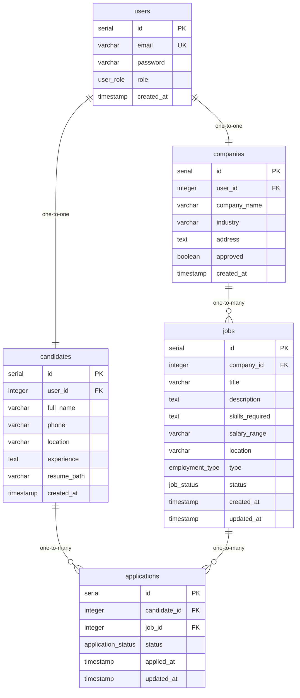

# 💼 Job Portal

> A modern, full-stack job portal application connecting job seekers with employers. Built with Spring Boot and React, featuring role-based access control, comprehensive job management, and real-time application tracking.


## 📋 Table of Contents

- [Features](#-features)
- [Demo](#-demo)
- [Technology Stack](#️-technology-stack)
- [Project Architecture](#-project-architecture)
- [Getting Started](#-getting-started)
- [API Documentation](#-api-documentation)
- [Frontend Features](#-frontend-features)
- [Database Schema](#️-database-schema)
- [Development](#-development)
- [Deployment](#-deployment)
- [Contributing](#-contributing)
- [License](#-license)

## ✨ Features

### 🔐 Authentication & Authorization
- **Multi-role system**: Candidates, Companies, and Admins
- **Secure registration** with email validation
- **Profile management** for different user types
- **Company approval workflow** for business verification

### 💼 Job Management
- **Complete CRUD operations** for job postings
- **Advanced search & filtering** by title, location, skills
- **Job categorization** by employment type and industry
- **Real-time application tracking**

### 🎯 Application System
- **One-click job applications** for candidates
- **Application status management** (Applied, Under Review, Interviewed, Rejected, Hired)
- **Resume upload and management**
- **Application history and tracking**

### 👥 User Dashboards
- **Candidate Dashboard**: Applied jobs, profile management, job recommendations
- **Company Dashboard**: Posted jobs, received applications, company profile
- **Admin Panel**: User management, company approvals, system oversight

### 🔍 Search & Discovery
- **Smart search algorithms** with keyword matching
- **Location-based filtering**
- **Skills and experience matching**
- **Job recommendations** based on user profile

## 🎬 Demo

<!-- Add screenshots or GIFs here -->
```
[Home Page Screenshot]
[Candidate Dashboard Screenshot]
[Company Dashboard Screenshot]
[Job Search Screenshot]
```

## 🛠️ Technology Stack

### Backend
- **Java 21** - Modern Java with latest features
- **Spring Boot 3.2.0** - Framework for production-ready applications
- **Spring Data JPA** - Database abstraction layer
- **Spring Security** - Authentication and authorization
- **PostgreSQL 14+** - Robust relational database
- **Lombok** - Reduces boilerplate code
- **Maven** - Dependency management and build automation
- **SpringDoc OpenAPI 3** - API documentation

### Frontend
- **React 18.2.0** - Modern UI library with hooks
- **Vite 5.0.8** - Fast build tool and dev server
- **React Router 6.20.1** - Client-side routing
- **Axios 1.6.2** - HTTP client for API calls
- **React Icons 4.12.0** - Icon library
- **Sonner 1.2.2** - Toast notifications

### Development Tools
- **ESLint** - Code linting and formatting
- **Hot Module Replacement** - Fast development with Vite
- **Swagger UI** - Interactive API documentation
- **PostgreSQL Client** - Database management

## 🏗️ Project Architecture

The application follows a modern full-stack architecture with clear separation of concerns:

```
📦 Job Portal
├── 🖥️  Frontend (React + Vite)
│   ├── 🎨 UI Components (Navbar, Footer, JobCard, SearchBar)
│   ├── 📄 Pages (Home, Dashboard, Profile, Job Management)
│   ├── 🔄 Context (AuthContext for state management)
│   ├── 🔧 Services (API communication layer)
│   └── 🎯 Hooks (Custom React hooks)
│
├── ⚡ Backend (Spring Boot)
│   ├── 🎮 Controllers (REST API endpoints)
│   ├── 💼 Services (Business logic layer)
│   ├── 🗄️  Repositories (Data access layer)
│   ├── 📊 Entities (JPA database models)
│   ├── 📬 DTOs (Data transfer objects)
│   └── 🔒 Security (Authentication & authorization)
│
├── 🗃️  Database (PostgreSQL)
│   ├── 👤 Users & Profiles
│   ├── 💼 Jobs & Applications
│   └── 🏢 Company Management
│
└── 🔧 DevOps
    ├── 🚀 Start/Stop Scripts
    ├── 📝 Configuration Files
    └── 📊 Sample Data
```

### Backend Structure
```
backend/
├── src/main/java/com/jobportal/
│   ├── JobPortalApplication.java           # Main application class
│   ├── config/                             # Configuration classes
│   │   ├── SecurityConfig.java             # Security configuration
│   │   ├── EmailConfig.java                # Email service setup
│   │   └── SwaggerConfig.java              # API documentation config
│   ├── controller/                         # REST API endpoints
│   │   ├── AuthController.java             # Authentication endpoints
│   │   ├── UserController.java             # User management
│   │   ├── CandidateController.java        # Candidate operations
│   │   ├── CompanyController.java          # Company management
│   │   ├── JobController.java              # Job CRUD operations
│   │   └── ApplicationController.java      # Application tracking
│   ├── dto/                                # Data Transfer Objects
│   │   ├── auth/                           # Authentication DTOs
│   │   ├── user/                           # User-related DTOs
│   │   ├── job/                            # Job-related DTOs
│   │   └── application/                    # Application DTOs
│   ├── entity/                             # JPA Database Models
│   │   ├── User.java                       # User entity
│   │   ├── Candidate.java                  # Candidate profile
│   │   ├── Company.java                    # Company profile
│   │   ├── Job.java                        # Job posting
│   │   └── Application.java                # Job application
│   ├── repository/                         # Data Access Layer
│   │   ├── UserRepository.java
│   │   ├── CandidateRepository.java
│   │   ├── CompanyRepository.java
│   │   ├── JobRepository.java
│   │   └── ApplicationRepository.java
│   ├── service/                            # Business Logic
│   │   ├── UserService.java
│   │   ├── CandidateService.java
│   │   ├── CompanyService.java
│   │   ├── JobService.java
│   │   └── ApplicationService.java
│   ├── security/                           # Security Components
│   └── util/                               # Utility classes
├── src/main/resources/
│   ├── application.properties              # Main configuration
│   └── static/resumes/                     # Resume storage
└── src/test/java/                          # Unit tests
```

### Frontend Structure
```
frontend/
├── public/                                 # Static assets
├── src/
│   ├── App.jsx                             # Main application component
│   ├── main.jsx                            # Application entry point
│   ├── index.css                           # Global styles
│   ├── components/                         # Reusable UI components
│   │   ├── Navbar.jsx                      # Navigation bar
│   │   ├── Footer.jsx                      # Page footer
│   │   ├── JobCard.jsx                     # Job listing card
│   │   ├── SearchBar.jsx                   # Job search component
│   │   └── NavigationButtons.jsx           # Navigation helpers
│   ├── pages/                              # Route components
│   │   ├── Home.jsx                        # Landing page
│   │   ├── Login.jsx                       # Login page
│   │   ├── Register.jsx                    # Registration page
│   │   ├── Profile.jsx                     # User profile
│   │   ├── JobListings.jsx                 # Browse jobs
│   │   ├── JobDetail.jsx                   # Job details view
│   │   ├── CandidateDashboard.jsx          # Candidate dashboard
│   │   ├── CompanyDashboard.jsx            # Company dashboard
│   │   ├── PostJob.jsx                     # Create job posting
│   │   ├── ManageJobs.jsx                  # Manage posted jobs
│   │   ├── ViewApplications.jsx            # View received applications
│   │   └── ApplicationTracking.jsx         # Track job applications
│   ├── context/                            # React Context
│   │   └── AuthContext.jsx                 # Authentication state
│   ├── services/                           # API Services
│   │   └── api.js                          # Axios API client
│   ├── utils/                              # Utility functions
│   │   └── errorHandler.js                 # Error handling
│   └── hooks/                              # Custom React hooks
├── package.json                            # Dependencies and scripts
└── vite.config.js                          # Vite configuration
```

## 🎨 Frontend Features

### User Interface Components

#### 🏠 Home Page
- **Hero section** with job search functionality
- **Featured jobs** carousel
- **Statistics dashboard** (total jobs, companies, applications)
- **Call-to-action** for registration

#### 🔐 Authentication System
- **Login/Register** forms with validation
- **Role selection** during registration (Candidate/Company)
- **Profile completion** wizards
- **Password strength** indicators

#### 👤 Candidate Features
- **Personal Dashboard** with application status
- **Job Search & Filtering** with advanced options
- **Application Tracking** with status updates
- **Profile Management** with resume upload
- **Job Recommendations** based on profile

#### 🏢 Company Features
- **Company Dashboard** with analytics
- **Job Posting** creation and management
- **Application Management** with candidate reviews
- **Company Profile** setup and verification
- **Applicant Communication** tools

#### 🔍 Search & Discovery
- **Smart Search Bar** with auto-suggestions
- **Advanced Filters** (location, salary, skills, experience)
- **Sort Options** (date, relevance, salary)
- **Saved Searches** functionality

### Component Library

```javascript
// Core Components
├── Navbar.jsx          // Navigation with user context
├── Footer.jsx          // Site footer with links
├── JobCard.jsx         // Reusable job listing card
├── SearchBar.jsx       // Advanced search component
└── NavigationButtons.jsx // Pagination and navigation

// Form Components
├── LoginForm.jsx       // Authentication form
├── RegisterForm.jsx    // User registration
├── ProfileForm.jsx     // Profile management
└── JobForm.jsx         // Job posting creation

// Dashboard Components
├── StatsCard.jsx       // Dashboard statistics
├── ApplicationCard.jsx // Application status card
├── JobTable.jsx        // Job management table
└── NotificationPanel.jsx // Real-time notifications
```

### State Management

The application uses React Context for state management:

```javascript
// AuthContext.jsx - Authentication state
const AuthContext = {
  user: null,              // Current user object
  isAuthenticated: false,  // Authentication status
  role: null,             // User role (CANDIDATE, COMPANY, ADMIN)
  login: (credentials) => {},
  logout: () => {},
  register: (userData) => {},
  updateProfile: (data) => {}
}
```

### Responsive Design

- 📱 **Mobile-first** approach with breakpoints
- 🖥️ **Desktop optimization** for productivity
- 📊 **Adaptive layouts** for different screen sizes
- ♿ **Accessibility** compliance (WCAG 2.1)

## 🗄️ Database Schema

### Database Overview

PostgreSQL database with optimized schema for job portal operations:

```sql
-- Core Tables
📋 users              (5 columns)    # Authentication & roles
👤 candidates         (8 columns)    # Job seeker profiles  
🏢 companies          (7 columns)    # Employer profiles
💼 jobs               (11 columns)   # Job postings
📄 applications       (6 columns)    # Application tracking
```

### Table Relationships



### Schema Details

#### 👤 Users Table
```sql
CREATE TABLE users (
    id SERIAL PRIMARY KEY,
    email VARCHAR(255) UNIQUE NOT NULL,
    password VARCHAR(255) NOT NULL,
    role VARCHAR(20) CHECK (role IN ('CANDIDATE', 'COMPANY', 'ADMIN')),
    created_at TIMESTAMP DEFAULT CURRENT_TIMESTAMP
);
```

#### 👥 Candidates Table  
```sql
CREATE TABLE candidates (
    id SERIAL PRIMARY KEY,
    user_id INTEGER REFERENCES users(id) ON DELETE CASCADE,
    full_name VARCHAR(255) NOT NULL,
    phone VARCHAR(20),
    location VARCHAR(255),
    experience TEXT,
    resume_path VARCHAR(500),
    created_at TIMESTAMP DEFAULT CURRENT_TIMESTAMP
);
```

#### 🏢 Companies Table
```sql
CREATE TABLE companies (
    id SERIAL PRIMARY KEY,
    user_id INTEGER REFERENCES users(id) ON DELETE CASCADE,
    company_name VARCHAR(255) NOT NULL,
    industry VARCHAR(255),
    address TEXT,
    approved BOOLEAN DEFAULT FALSE,
    created_at TIMESTAMP DEFAULT CURRENT_TIMESTAMP
);
```

#### 💼 Jobs Table
```sql
CREATE TABLE jobs (
    id SERIAL PRIMARY KEY,
    company_id INTEGER REFERENCES companies(id) ON DELETE CASCADE,
    title VARCHAR(255) NOT NULL,
    description TEXT NOT NULL,
    skills_required TEXT,
    salary_range VARCHAR(100),
    location VARCHAR(255),
    employment_type VARCHAR(20) CHECK (employment_type IN ('FULL_TIME', 'PART_TIME', 'CONTRACT', 'INTERNSHIP')),
    status VARCHAR(20) DEFAULT 'ACTIVE' CHECK (status IN ('ACTIVE', 'CLOSED', 'DRAFT')),
    created_at TIMESTAMP DEFAULT CURRENT_TIMESTAMP,
    updated_at TIMESTAMP DEFAULT CURRENT_TIMESTAMP
);
```

#### 📄 Applications Table
```sql
CREATE TABLE applications (
    id SERIAL PRIMARY KEY,
    candidate_id INTEGER REFERENCES candidates(id) ON DELETE CASCADE,
    job_id INTEGER REFERENCES jobs(id) ON DELETE CASCADE,
    status VARCHAR(20) DEFAULT 'APPLIED' CHECK (status IN ('APPLIED', 'UNDER_REVIEW', 'INTERVIEWED', 'REJECTED', 'HIRED')),
    applied_at TIMESTAMP DEFAULT CURRENT_TIMESTAMP,
    updated_at TIMESTAMP DEFAULT CURRENT_TIMESTAMP,
    UNIQUE(candidate_id, job_id)
);
```

### Indexes for Performance

```sql
-- Improve query performance
CREATE INDEX idx_users_email ON users(email);
CREATE INDEX idx_jobs_company_id ON jobs(company_id);
CREATE INDEX idx_jobs_location ON jobs(location);
CREATE INDEX idx_jobs_title ON jobs(title);
CREATE INDEX idx_applications_candidate_id ON applications(candidate_id);
CREATE INDEX idx_applications_job_id ON applications(job_id);
CREATE INDEX idx_jobs_created_at ON jobs(created_at DESC);
```

## 🚀 Getting Started

### Prerequisites

Before running the application, ensure you have the following installed:

- **Java 21** or higher ([Download](https://openjdk.org/projects/jdk/21/))
- **Node.js 18+** ([Download](https://nodejs.org/))
- **Maven 3.8+** ([Download](https://maven.apache.org/download.cgi))
- **PostgreSQL 14+** ([Download](https://www.postgresql.org/download/))
- **Git** ([Download](https://git-scm.com/downloads))

### Quick Start

1. **Clone the repository**
   ```bash
   git clone https://github.com/your-username/job-portal.git
   cd job-portal
   ```

2. **Set up the database**
   ```bash
   # Create PostgreSQL database
   createdb jobportal
   
   # Run database schema
   psql -d jobportal -f database/jobportal.sql
   
   # (Optional) Load sample data
   psql -d jobportal -f database/seed-data.sql
   ```

3. **Configure the backend**
   
   Update `backend/src/main/resources/application.properties`:
   ```properties
   # Database Configuration
   spring.datasource.url=jdbc:postgresql://localhost:5432/jobportal
   spring.datasource.username=your_username
   spring.datasource.password=your_password
   
   # JPA Configuration
   spring.jpa.hibernate.ddl-auto=update
   spring.jpa.show-sql=true
   spring.jpa.properties.hibernate.dialect=org.hibernate.dialect.PostgreSQLDialect
   
   # Server Configuration
   server.port=8080
   
   # Email Configuration (Optional)
   spring.mail.host=smtp.gmail.com
   spring.mail.port=587
   spring.mail.username=your_email@gmail.com
   spring.mail.password=your_app_password
   ```

4. **Start the services using the provided scripts**
   ```bash
   # Make scripts executable (macOS/Linux)
   chmod +x start stop
   
   # Start both backend and frontend services
   ./start
   ```

   **Or start services individually:**
   ```bash
   # Terminal 1 - Backend
   cd backend
   mvn spring-boot:run
   
   # Terminal 2 - Frontend
   cd frontend
   npm install
   npm run dev
   ```

5. **Access the application**
   - **Frontend**: http://localhost:5173
   - **Backend API**: http://localhost:8080
   - **API Documentation**: http://localhost:8080/swagger-ui/index.html

### Using the Start/Stop Scripts

The project includes convenient scripts for managing both services:

```bash
# Start both backend and frontend
./start

# Stop all services
./stop
```

These scripts handle:
- ✅ Automatic dependency installation
- ✅ Service health checks
- ✅ Graceful shutdown
- ✅ Process management
- ✅ Logging and error handling

## 📚 API Documentation

### Interactive API Explorer

Access the complete API documentation at: **http://localhost:8080/swagger-ui/index.html**

The Swagger UI provides:
- 📖 Complete endpoint documentation
- 🧪 Interactive API testing
- 📝 Request/response examples
- 🔍 Schema definitions
- 🔐 Authentication testing

### Core API Endpoints

#### Authentication
```http
POST   /api/auth/register     # User registration
POST   /api/auth/login        # User authentication
POST   /api/auth/logout       # User logout
GET    /api/auth/me           # Get current user
```

#### User Management
```http
GET    /api/users             # Get all users (Admin only)
GET    /api/users/{id}        # Get user by ID
PUT    /api/users/{id}        # Update user profile
DELETE /api/users/{id}        # Delete user (Admin only)
```

#### Candidate Operations
```http
GET    /api/candidates                    # Get all candidates
GET    /api/candidates/{id}               # Get candidate by ID
GET    /api/candidates/user/{userId}      # Get candidate by user ID
POST   /api/candidates                    # Create candidate profile
PUT    /api/candidates/{id}               # Update candidate profile
DELETE /api/candidates/{id}               # Delete candidate
```

#### Company Operations
```http
GET    /api/companies                     # Get all companies
GET    /api/companies/{id}                # Get company by ID
GET    /api/companies/user/{userId}       # Get company by user ID
POST   /api/companies                     # Create company profile
PUT    /api/companies/{id}                # Update company profile
DELETE /api/companies/{id}                # Delete company
PUT    /api/companies/{id}/approve        # Approve company (Admin only)
```

#### Job Management
```http
GET    /api/jobs                          # Get all jobs
GET    /api/jobs/{id}                     # Get job by ID
GET    /api/jobs/company/{companyId}      # Get jobs by company
GET    /api/jobs/search                   # Search jobs
POST   /api/jobs                          # Create job posting
PUT    /api/jobs/{id}                     # Update job posting
DELETE /api/jobs/{id}                     # Delete job posting
```

#### Application Tracking
```http
GET    /api/applications                  # Get all applications
GET    /api/applications/{id}             # Get application by ID
GET    /api/applications/candidate/{id}   # Get candidate's applications
GET    /api/applications/job/{id}         # Get job applications
POST   /api/applications                  # Submit job application
PUT    /api/applications/{id}/status      # Update application status
DELETE /api/applications/{id}             # Withdraw application
```

### Search Parameters

#### Job Search
```http
GET /api/jobs/search?title=developer&location=remote&skills=java,react&salaryMin=50000&salaryMax=100000
```

### Response Format

All API responses follow a consistent format:
```json
{
  "success": true,
  "data": { /* response data */ },
  "message": "Operation completed successfully",
  "timestamp": "2025-12-01T10:30:00Z"
}
```

Error responses:
```json
{
  "success": false,
  "error": {
    "code": "VALIDATION_ERROR",
    "message": "Invalid input data",
    "details": { /* specific error details */ }
  },
  "timestamp": "2025-12-01T10:30:00Z"
}
```

## 🔨 Development

### Development Environment Setup

#### Backend Development
```bash
cd backend

# Run in development mode with hot reload
mvn spring-boot:run

# Run tests
mvn test

# Build for production
mvn clean package

# Run with custom profile
mvn spring-boot:run -Dspring.profiles.active=dev
```

#### Frontend Development
```bash
cd frontend

# Install dependencies
npm install

# Start development server with hot reload
npm run dev

# Build for production
npm run build

# Preview production build
npm run preview

# Run linter
npm run lint
```

### Code Quality & Standards

#### Backend Code Standards
- ✅ **Java 21** features and best practices
- ✅ **Spring Boot** conventions and annotations
- ✅ **Lombok** for reducing boilerplate
- ✅ **JPA** naming conventions
- ✅ **RESTful** API design principles
- ✅ **DTOs** for data transfer
- ✅ **Exception handling** with global handlers

#### Frontend Code Standards
- ✅ **ES6+** modern JavaScript features
- ✅ **React Hooks** over class components
- ✅ **Component composition** patterns
- ✅ **Props validation** with PropTypes
- ✅ **ESLint** configuration
- ✅ **Consistent** naming conventions

#### Database Standards
- ✅ **Snake_case** for table and column names
- ✅ **Serial** primary keys for consistency
- ✅ **Foreign key** constraints
- ✅ **Proper indexing** for performance
- ✅ **Meaningful** column names

### Testing Strategy

#### Backend Testing
```bash
# Run all tests
mvn test

# Run specific test class
mvn test -Dtest=UserServiceTest

# Run with coverage
mvn test jacoco:report
```

#### Frontend Testing
```bash
# Run unit tests (when implemented)
npm run test

# Run E2E tests (when implemented)  
npm run test:e2e
```

### Environment Configuration

#### Development (`application-dev.properties`)
```properties
# Development database
spring.datasource.url=jdbc:postgresql://localhost:5432/jobportal_dev
spring.jpa.show-sql=true
spring.jpa.hibernate.ddl-auto=update

# Logging
logging.level.com.jobportal=DEBUG
logging.level.org.springframework.web=DEBUG

# CORS for development
cors.allowed-origins=http://localhost:5173
```

#### Production (`application-prod.properties`)
```properties
# Production database
spring.datasource.url=${DATABASE_URL}
spring.jpa.show-sql=false
spring.jpa.hibernate.ddl-auto=validate

# Security
server.port=${PORT:8080}
spring.profiles.active=prod

# CORS for production
cors.allowed-origins=${FRONTEND_URL}
```

### Docker Support (Optional)

#### Backend Dockerfile
```dockerfile
FROM openjdk:21-jdk-slim
WORKDIR /app
COPY target/job-portal-backend-0.0.1-SNAPSHOT.jar app.jar
EXPOSE 8080
ENTRYPOINT ["java", "-jar", "app.jar"]
```

#### Frontend Dockerfile  
```dockerfile
FROM node:18-alpine AS builder
WORKDIR /app
COPY package*.json ./
RUN npm ci
COPY . .
RUN npm run build

FROM nginx:alpine
COPY --from=builder /app/dist /usr/share/nginx/html
EXPOSE 80
```

#### Docker Compose
```yaml
version: '3.8'
services:
  database:
    image: postgres:14
    environment:
      POSTGRES_DB: jobportal
      POSTGRES_USER: jobuser
      POSTGRES_PASSWORD: jobpass
    volumes:
      - postgres_data:/var/lib/postgresql/data
    ports:
      - "5432:5432"

  backend:
    build: ./backend
    ports:
      - "8080:8080"
    depends_on:
      - database
    environment:
      SPRING_DATASOURCE_URL: jdbc:postgresql://database:5432/jobportal
      SPRING_DATASOURCE_USERNAME: jobuser
      SPRING_DATASOURCE_PASSWORD: jobpass

  frontend:
    build: ./frontend
    ports:
      - "80:80"
    depends_on:
      - backend

volumes:
  postgres_data:
```

## 🚀 Deployment

### Backend Deployment Options

#### 1. JAR Deployment
```bash
# Build the JAR
mvn clean package

# Run the JAR
java -jar target/job-portal-backend-0.0.1-SNAPSHOT.jar

# With custom properties
java -jar -Dspring.profiles.active=prod target/job-portal-backend-0.0.1-SNAPSHOT.jar
```

#### 2. Cloud Deployment (Heroku)
```bash
# Install Heroku CLI and login
heroku login

# Create app
heroku create job-portal-backend

# Add PostgreSQL addon
heroku addons:create heroku-postgresql:mini

# Deploy
git push heroku main
```

#### 3. AWS/Azure Deployment
- **AWS Elastic Beanstalk** - Easy Java application deployment
- **Azure App Service** - Managed platform for Spring Boot
- **Google Cloud Platform** - App Engine for Java applications

### Frontend Deployment Options

#### 1. Static Hosting (Netlify/Vercel)
```bash
# Build for production
npm run build

# Deploy to Netlify
netlify deploy --prod --dir=dist

# Deploy to Vercel
vercel --prod
```

#### 2. CDN Deployment
- **AWS CloudFront** with S3
- **Azure CDN** with Storage Account
- **Google Cloud CDN** with Cloud Storage

### Database Deployment

#### Production Database Options
1. **Managed PostgreSQL**
   - AWS RDS PostgreSQL
   - Azure Database for PostgreSQL
   - Google Cloud SQL
   - DigitalOcean Managed Databases

2. **Self-Hosted**
   - Docker containers
   - VM instances
   - Kubernetes clusters

### Environment Variables

#### Backend Environment Variables
```bash
# Database
DATABASE_URL=jdbc:postgresql://localhost:5432/jobportal
DATABASE_USERNAME=your_username
DATABASE_PASSWORD=your_password

# Server
SERVER_PORT=8080
SPRING_PROFILES_ACTIVE=prod

# CORS
CORS_ALLOWED_ORIGINS=https://your-frontend-domain.com

# Email (optional)
MAIL_HOST=smtp.gmail.com
MAIL_PORT=587
MAIL_USERNAME=your_email@gmail.com
MAIL_PASSWORD=your_app_password
```

#### Frontend Environment Variables
```bash
# API Configuration
VITE_API_BASE_URL=https://your-backend-domain.com
VITE_APP_NAME=Job Portal
VITE_APP_VERSION=1.0.0

# Feature Flags
VITE_ENABLE_ANALYTICS=true
VITE_ENABLE_NOTIFICATIONS=true
```

## 🤝 Contributing

We welcome contributions to the Job Portal project! Here's how you can help:

### Getting Started
1. **Fork** the repository
2. **Clone** your fork locally
3. **Create** a feature branch
4. **Make** your changes
5. **Test** thoroughly
6. **Submit** a pull request

### Contribution Guidelines

#### Code Standards
- Follow existing code style and conventions
- Write meaningful commit messages
- Add tests for new features
- Update documentation as needed
- Ensure all tests pass before submitting

#### Pull Request Process
1. **Update** the README if needed
2. **Add/update** tests for your changes
3. **Ensure** the build passes
4. **Request** review from maintainers

#### Reporting Issues
- Use the GitHub issue tracker
- Provide detailed reproduction steps
- Include environment information
- Add relevant labels

### Development Areas

We're looking for contributions in:
- 🐛 **Bug fixes** and improvements
- ✨ **New features** and enhancements
- 📚 **Documentation** updates
- 🧪 **Test coverage** improvements
- 🎨 **UI/UX** enhancements
- 🔒 **Security** improvements

## 📄 License

This project is licensed under the **MIT License** - see the [LICENSE](LICENSE) file for details.

### MIT License Summary
```
Permission is hereby granted, free of charge, to any person obtaining a copy
of this software and associated documentation files (the "Software"), to deal
in the Software without restriction, including without limitation the rights
to use, copy, modify, merge, publish, distribute, sublicense, and/or sell
copies of the Software.
```

## 📞 Support & Contact

### Getting Help
- 📖 **Documentation**: Check this README and API documentation
- 🐛 **Issues**: Create a GitHub issue for bugs
- 💡 **Feature Requests**: Open a GitHub discussion
- 📧 **Contact**: [your-email@example.com]

### Community
- 🌟 **Star** the project if you find it useful
- 🍴 **Fork** and contribute improvements
- 📢 **Share** with the developer community

---

<div align="center">
<h3>Built with ❤️ for the developer community</h3>

[](https://openjdk.org/projects/jdk/21/)
[](https://spring.io/projects/spring-boot)
[](https://reactjs.org/)
[](https://www.postgresql.org/)

**[⬆ Back to Top](#-job-portal)**
</div>